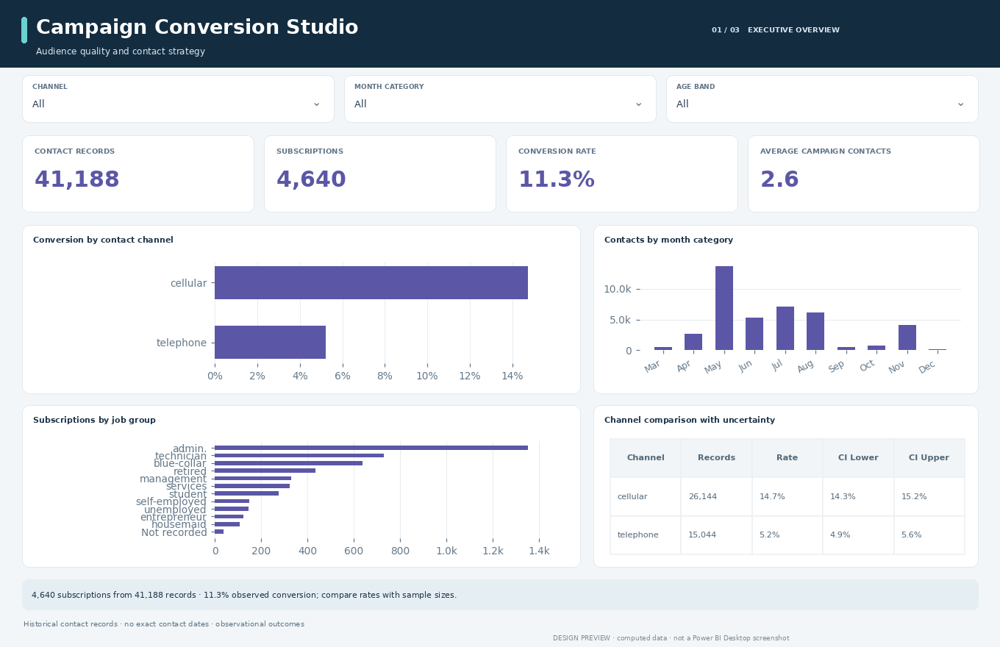
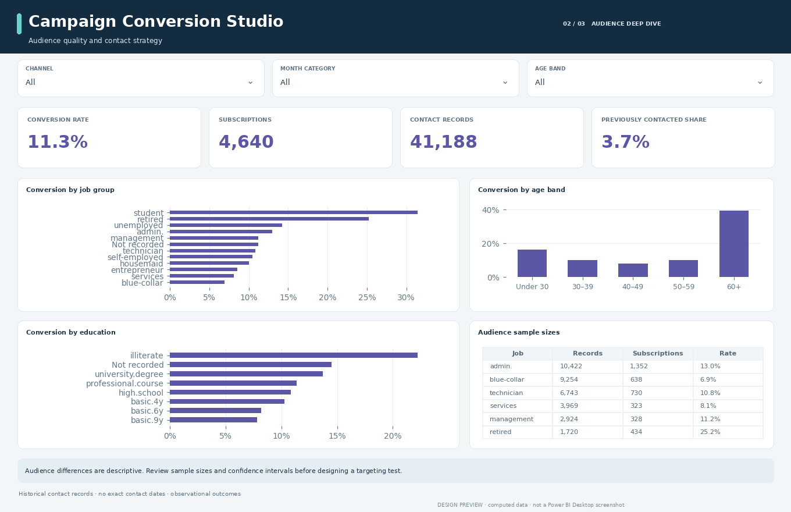
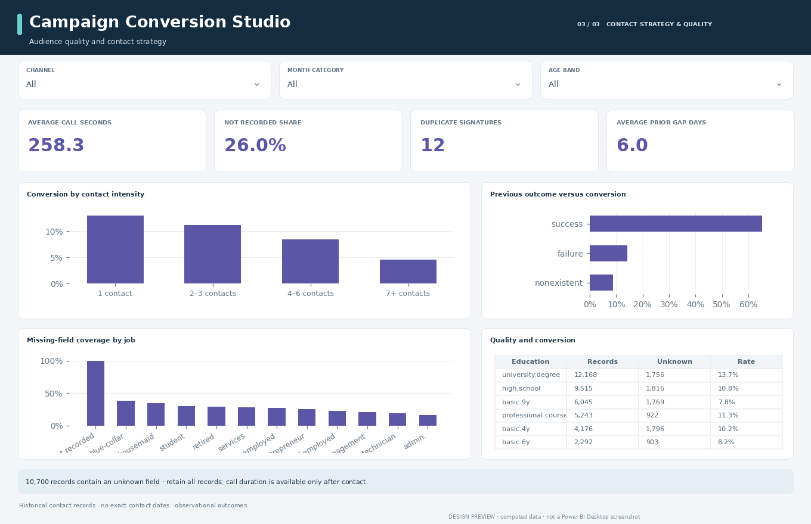

# Campaign Conversion Studio

Which contact groups show different subscription rates, and how reliable are those comparisons?

An audited UCI data analysis and editable three-page Power BI report for campaign analysts and marketing operations teams.

**Delivery status:** data cleaning, analysis and source-format checks complete. Power BI Desktop refresh, DAX/M execution and native rendering await verification. Images are computed design previews, not Desktop screenshots.

## Findings at a glance

| Metric | Audited snapshot |
| :--- | ---: |
| Contact records | 41,188 |
| Subscriptions | 4,640 |
| Observed conversion | 11.27% |
| Records with unknown fields | 10,700 |

41,188 original records → **41,188 retained fact rows**. See the [analysis findings](analysis/FINDINGS.md) and [cleaning audit](analysis/cleaning_audit.json) for the complete accounting.

## Report experience

| Page | Interpretation |
| :--- | :--- |
| 01 · Executive overview | 4,640 subscriptions from 41,188 records · 11.3% observed conversion; compare rates with sample sizes. |
| 02 · Audience deep dive | Audience differences are descriptive. Review sample sizes and confidence intervals before designing a targeting test. |
| 03 · Contact strategy & quality | 10,700 records contain an unknown field · retain all records; call duration is available only after contact. |

Three report tabs move from an executive overview to segment detail and data quality. Dropdown slicers provide context; category charts expose the relevant record-count denominators through tooltips. Measures recalculate with filters except where an explicit definition documents otherwise. Tables rank by the first metric unless calendar order is required. Native slicer and selection behavior still requires Desktop testing.

| Segment detail | Quality and context |
| :---: | :---: |
|  |  |

## Decisions this analysis supports

**Channel evaluation.** Use channel differences to propose a controlled test, with explicit sample sizes. Channel rates describe different observed populations and do not establish channel effectiveness.

**Audience review.** Check contact counts and the Wilson interval before prioritizing a segment. Small groups may have high observed rates with considerable uncertainty.

**Feature governance.** Exclude call duration from any future pre-contact targeting feature set. Duration is only known after contact; using it before a call would leak future information.

## Analytical boundaries

There is no customer identifier, exact contact date or year in this selected file. Month is a category, not a chronological sequence. Keep the 12 repeated signatures because they may represent different people. Do not turn segment associations into creditworthiness decisions or claim campaign uplift.

Rates use explicit denominators; no targets, profit figures, forecasts or causal effects are invented. [Metric contract](docs/METRIC_CONTRACT.md) · [DAX definitions](docs/MEASURES.md) · [Data dictionary](data_dictionary.csv).

## Project contents

| Location | Purpose |
| :--- | :--- |
| `powerbi/Dashboard.pbip` | Power BI Desktop entry point |
| `powerbi/Dashboard.Report/` | Editable native report pages, visuals and theme |
| `powerbi/Dashboard.SemanticModel/` | Relationships, M imports and DAX measures |
| `data/raw/` | Unmodified source snapshot and provenance hashes |
| `data/clean/` | Cleaned fact and dimension tables |
| `analysis/` | Findings, grouped analysis, cleaning and validation audits |
| `docs/` | Metric contract, report guide and native review checklist |
| `scripts/` | Cleaning, report generation and integrity validation |

[Power BI setup](POWER_BI_SETUP.md) · [Report guide](docs/REPORT_GUIDE.md) · [Validation status](analysis/validation_report.json).

## Source and license

Dataset attribution and source links: [DATA_LICENSE.md](DATA_LICENSE.md). Code: MIT. Dataset: CC BY 4.0. This is a historical analytical portfolio project, not a live operational feed.

